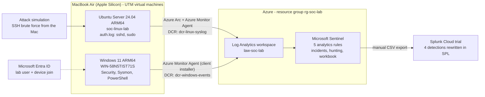

# Architecture

## Data flow

## Components

| Component | Role |
| --- | --- |
| UTM | Hypervisor for Apple Silicon, hosts both VMs |
| Ubuntu Server 24.04 ARM64 | Linux endpoint, SSH and sudo activity |
| Windows 11 ARM64 | Windows endpoint, Sysmon, PowerShell logging, Security auditing |
| Azure Arc + Azure Monitor Agent | Linux log collection (Arc agent is not supported on Windows 11 ARM64) |
| Azure Monitor Agent client installer | Windows log collection, authenticated with the Entra device identity |
| Data Collection Rules | Define which events are collected and where they go |
| Log Analytics workspace | Stores the logs |
| Microsoft Sentinel | Detection rules, incidents, hunting queries, workbook |
| Splunk Cloud trial | Second SIEM; detections re-implemented in SPL on exported data |

## Notes

* The Splunk path is a **manual CSV export and upload**, not a live forwarder.
* The Linux and Windows agents use different authentication: Linux uses the Azure Arc managed identity; Windows uses a Microsoft Entra device token.
